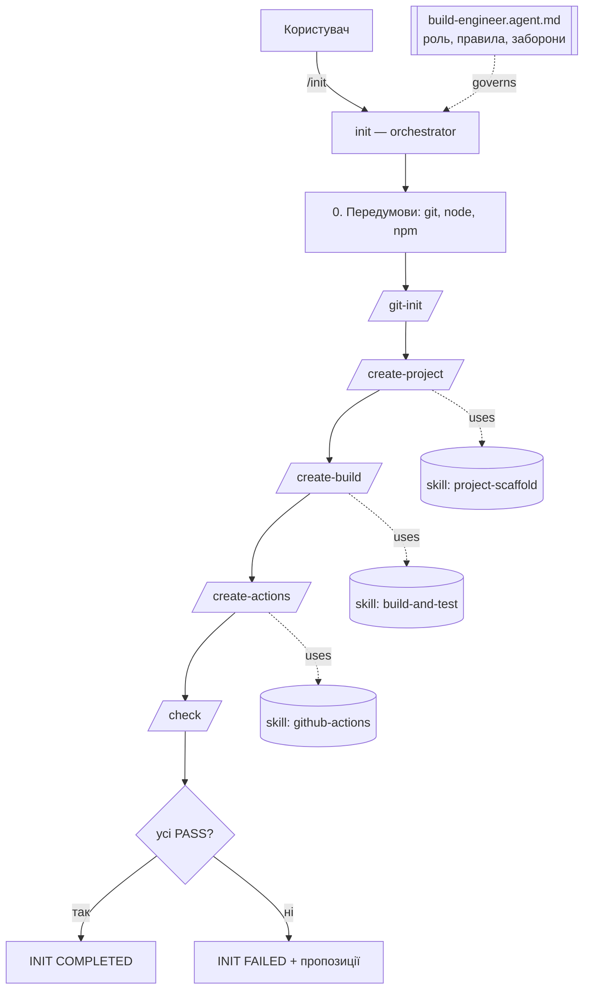

# Архітектура AI-агента build-engineer

## Яку задачу вирішує агент
Створення з нуля і перевірка кросплатформного TypeScript Hello World-проєкту:
вихідний код, складання (npm scripts + `tsc`), юніт-тести (Vitest), скрипти `ci.sh`/`ci.bat`
і GitHub Actions для Windows, Linux, macOS. Агент робить це за однаковим, відтворюваним процесом
і не вважає роботу завершеною без перевірок.

## Середовище
GitHub Copilot Chat у VS Code (режим Agent). Copilot використовує такі формати:

| Роль у методичці | Файл у репозиторії | Формат Copilot |
|---|---|---|
| Agent manifest | `.github/agents/build-engineer.agent.md` | custom agent (`*.agent.md`) |
| Skill | `.github/skills/<name>/SKILL.md` | agent skill (`SKILL.md`) |
| Command | `.github/prompts/<name>.prompt.md` | prompt file, запуск як `/<name>` |
| Orchestrator | `.github/prompts/init.prompt.md` | prompt file `/init` |
| CI | `.github/workflows/ci.yml` | GitHub Actions |

## Взаємодія компонентів

## Skills
| Skill | Вхід | Вихід | Перевірки |
|---|---|---|---|
| project-scaffold | language, projectName | `src/hello.ts`, `src/math.ts`, README, `.gitignore` | файли існують, `add` експортується, без дублікатів у `.gitignore` |
| build-and-test | `src/*.ts` | `package.json`, tsconfig, `tests/math.test.ts`, `ci.sh`, `ci.bat` | build, `Hello, World!`, `BasicAddition` passed, `CI PASS` |
| github-actions | `ci.sh`, `ci.bat` | `.github/workflows/ci.yml` | 3 ОС, тригери, лише виклик скриптів, без секретів |

## Commands
| Command | Дія | Змінює файли |
|---|---|---|
| `/git-init` | перевірка репо, `.gitignore`, `git status` | `.gitignore` |
| `/create-project` | project-scaffold | так |
| `/create-build` | build-and-test | так |
| `/create-actions` | github-actions | так |
| `/check` | 21 перевірка (агент, проєкт, build, CI, Git) | ні |
| `/init` | оркестратор | так |

## Дані між етапами
`.gitignore` → `src/*.ts` → `package.json` + `ci.sh`/`ci.bat` → `ci.yml` → звіт `/check`.
Кожна команда перевіряє наявність результату попереднього кроку як передумову.

## Обробка помилок
- Кожен крок завершується статусом `PASS` / `SKIP` / `FAIL`.
- `FAIL` → оркестратор зупиняється, виводить причину і пропозицію; наступні кроки не запускаються.
- Заборонено «проходити» перевірку, видаляючи тест або послаблюючи умову.
- Повторний запуск безпечний: існуючі коректні файли отримують `SKIP`.

## Обмеження агента
- Підтримує лише варіант 6 (TypeScript + npm + Vitest).
- Не комітить і не пушить сам — лише пропонує команди.
- Перевірка YAML локально залежить від наявних інструментів; остаточна перевірка — запуск у GitHub Actions.
- Результат генерації LLM може відрізнятися між запусками; стабільність забезпечують шаблони в skills і `/check`.
